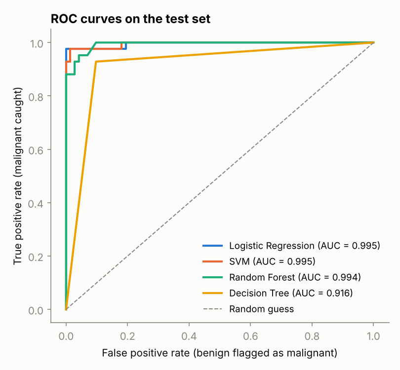
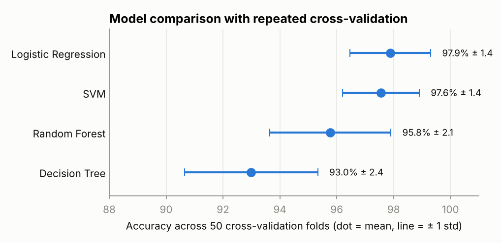
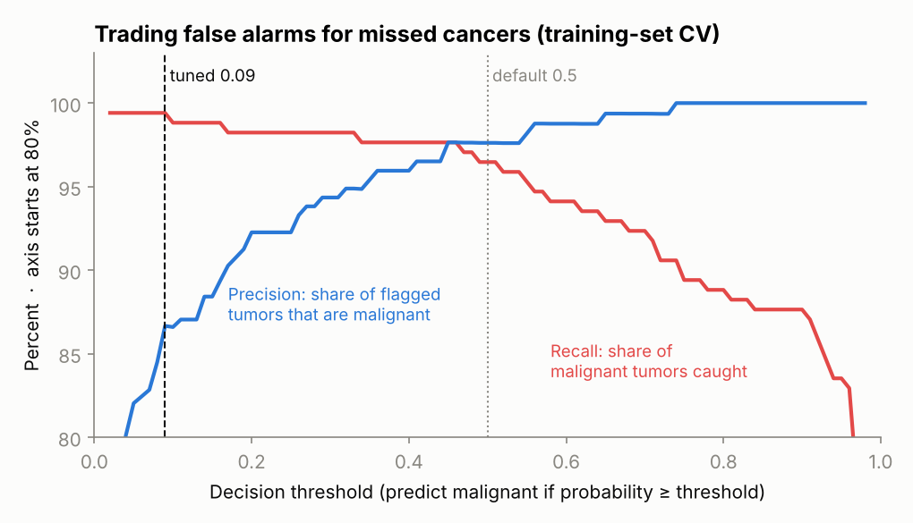
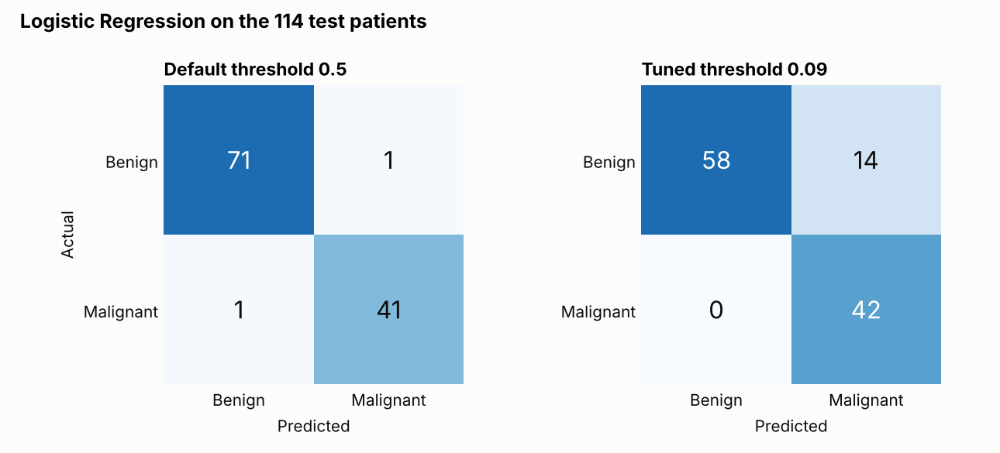
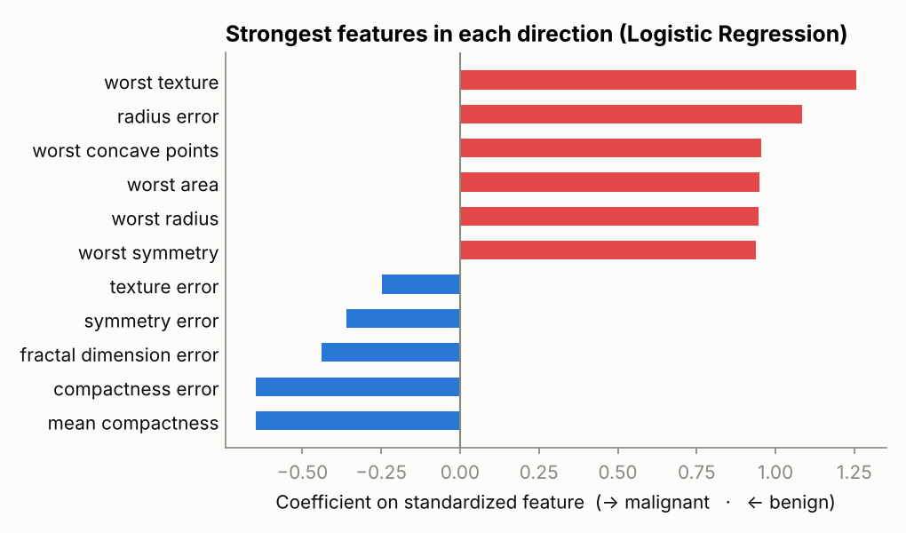

# Breast Cancer Diagnosis with Machine Learning

Classifying breast tumors as malignant or benign from 30 measurements of cell nuclei, comparing four models: Logistic Regression, SVM, Random Forest, and a Decision Tree. The project then tunes the model's decision threshold so it misses fewer cancers.

**Team project** for CCDS 322 Applied Machine Learning, University of Jeddah (May 2026).
Team: Nawaf Alghamdi, Ismaeel Jan, Mansour Almistadi, Faris Eid.

This repository is my rebuild of the team project as reproducible code. The original was presented as a slide deck. The rebuild reproduces its headline results exactly, and it corrects how two of the metrics were reported.

## Problem

Fine-needle aspiration takes a small tissue sample from a breast lump, and the cell nuclei in the sample are measured under a microscope. The task is to predict from those measurements whether the tumor is **malignant** (cancerous) or **benign**. A model like this could support a pathologist's decision; it is not meant to replace one.

The two possible errors have very different costs. A **missed cancer** (a false negative) can delay treatment. A **false alarm** (a false positive) leads to further tests. So the most important metric is **recall on malignant tumors**: the share of cancers the model catches.

## Dataset

The [Wisconsin Diagnostic Breast Cancer dataset](https://archive.ics.uci.edu/dataset/17/breast+cancer+wisconsin+diagnostic), included in scikit-learn as `load_breast_cancer`.

- **Samples:** 569 tumors, 212 malignant (37%) and 357 benign (63%). No missing values.
- **Features:** 30, built from 10 measurements of the cell nuclei (radius, texture, perimeter, area, smoothness, compactness, concavity, concave points, symmetry, fractal dimension). Each measurement is summarized three ways across the nuclei in an image: the mean, the standard error ("error"), and the largest values ("worst").

## Approach

1. **Split:** stratified 80/20 train/test split with `random_state=42` (455 / 114 tumors), the same split as the course project. The test set has 42 malignant tumors.
2. **Preprocessing:** standard scaling for Logistic Regression and SVM, inside a `Pipeline` so it is fitted on training data only. Tree models use the raw features.
3. **Models:** Logistic Regression, SVM (RBF kernel), Random Forest, and Decision Tree, with scikit-learn defaults.
4. **Evaluation:** test-set metrics as in the course project, plus **repeated stratified cross-validation** (5 folds × 10 repeats = 50 folds on all 569 tumors) for a more reliable comparison.
5. **Threshold tuning:** choose the decision threshold using only the training data, then check it on the test set.

## Results

### Reproducing the course results

| Model | Test Accuracy | Precision | Recall | F1 | ROC-AUC | Missed cancers | False alarms |
|---|---|---|---|---|---|---|---|
| **Logistic Regression** | **0.982** | 0.976 | **0.976** | 0.976 | **0.995** | **1** | 1 |
| SVM | 0.982 | 0.976 | 0.976 | 0.976 | 0.995 | 1 | 1 |
| Random Forest | 0.956 | 0.951 | 0.929 | 0.940 | 0.994 | 3 | 2 |
| Decision Tree | 0.912 | 0.848 | 0.929 | 0.886 | 0.916 | 3 | 7 |

Precision, recall and F1 are for the **malignant** class.

The Logistic Regression and SVM results match the course slides exactly (accuracy 0.982, ROC-AUC 0.995). The Random Forest and Decision Tree numbers differ slightly from the slides (0.947 and 0.939 accuracy there), probably because the original used different settings that weren't recorded in the slides.

**A correction to the slides.** The slides report F1 and recall of 0.986 for Logistic Regression and say recall matters because "missing malignant cases can have serious consequences." But scikit-learn codes **benign** as class 1, and metrics are computed for class 1 by default. So 0.986 is the recall on *benign* tumors. Recall on malignant tumors, the number the slides meant, is **0.976**: 41 of the 42 cancers in the test set were caught. This repository relabels the data so that malignant = 1 and every metric refers to cancer detection.



### A more reliable comparison

With only 114 test tumors, each one is worth almost a full percentage point of accuracy, so one lucky or unlucky split can reorder the models. Repeated cross-validation trains and tests each model 50 times on different splits:

| Model | CV Accuracy | CV Recall (malignant) | CV ROC-AUC |
|---|---|---|---|
| **Logistic Regression** | **0.979 ± 0.014** | 0.958 ± 0.034 | 0.995 ± 0.005 |
| SVM | 0.976 ± 0.014 | 0.959 ± 0.031 | 0.995 ± 0.005 |
| Random Forest | 0.958 ± 0.021 | 0.933 ± 0.050 | 0.990 ± 0.009 |
| Decision Tree | 0.930 ± 0.024 | 0.907 ± 0.050 | 0.925 ± 0.028 |



This confirms the course project's conclusion. Logistic Regression and SVM are tied for best, and the gap between them is far smaller than the variation across folds. A single Decision Tree is clearly the weakest and the least stable, which supports hypothesis H2 from the course project. Logistic Regression remains the sensible final choice because it is as accurate as SVM and much easier to explain.

### Missing fewer cancers

By default, a model predicts malignant when its probability is at least 0.5. Nothing about that cutoff is medical: when a missed cancer costs far more than a false alarm, a lower threshold makes sense.

The threshold was chosen on the **training data only**, using 5-fold cross-validated predictions. The rule: the highest threshold that catches at least 99% of malignant tumors. That gives **0.09**.



On the training data, lowering the threshold from 0.5 to 0.09 cut missed cancers from 6 to 1, at the cost of 26 false alarms instead of 4. Applied to the held-out test set:



| Threshold | Missed cancers | False alarms | Recall (malignant) | Precision | Accuracy |
|---|---|---|---|---|---|
| Default 0.5 | 1 | 1 | 0.976 | 0.976 | 0.982 |
| Tuned 0.09 | **0** | 14 | **1.000** | 0.750 | 0.877 |

The tuned model caught all 42 cancers in the test set but flagged 14 benign tumors for follow-up. Accuracy drops from 98% to 88%, which shows why accuracy alone is the wrong measure for this problem. Whether this trade-off is right is a clinical decision. The point is that the threshold is a choice that should be made deliberately, not left at 0.5.

### What the model looks at



The features pushing hardest toward malignant are the "worst" (largest) measurements: texture, concave points, area, radius, and symmetry. Larger, more irregular nuclei are a classic sign of malignancy.

Treat the individual coefficients with care. Radius, perimeter, and area are almost perfectly correlated, so the model can split weight among them unpredictably. That is likely why a few related features, like mean compactness, show up pointing toward benign. The overall pattern is more trustworthy than any single coefficient.

## Limitations

- **Small dataset:** 569 tumors from one hospital in Wisconsin, collected in the early 1990s. The results may not hold for other populations, labs, or imaging equipment.
- **Optimistic for real use:** the features are measured from carefully selected digitized images. A deployed system would face noisier inputs.
- **One test set:** the tuned threshold was checked on only 42 malignant tumors, so "0 missed" is encouraging but not proof. Repeated cross-validation is the better guide to typical performance.

## Project structure

```
├── src/
│   ├── train.py      # data loading, models, evaluation, threshold tuning, figures
│   └── style.py      # shared chart styling
├── reports/
│   ├── metrics.json  # all numbers from the last run
│   └── figures/      # charts used in this README
└── requirements.txt
```

## How to run

```bash
pip install -r requirements.txt
python src/train.py
```

The dataset ships with scikit-learn, so no download is needed. The script runs in about 15 seconds.
